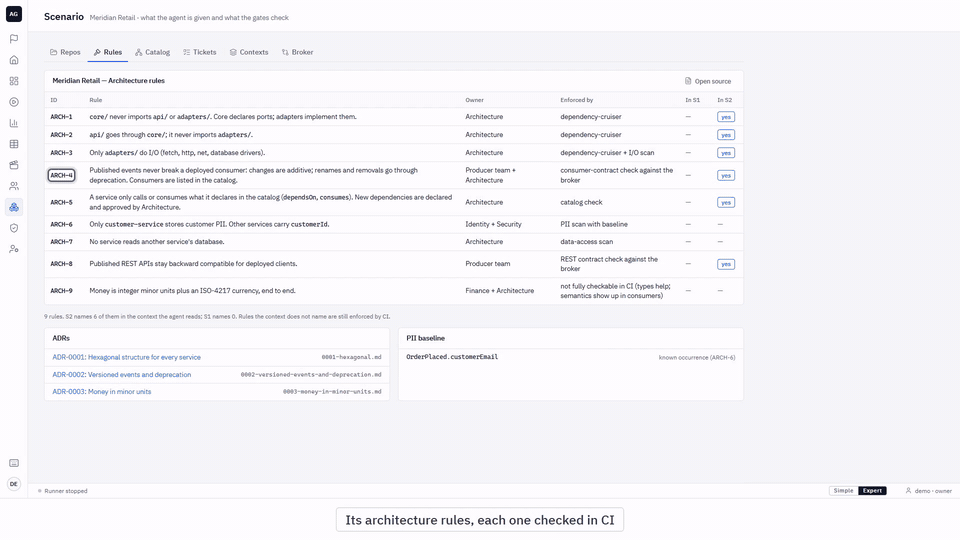

# Agents vs. Gates

**The AI-SDLC is here: every role now works with an agent. But nobody runs the architecture rules. This repo measures that gap, and gives you the tool to measure it in your own AI-SDLC.**

Does a coding agent break the teams it cannot see? And what stops it: a rule in its spec, or a gate in CI? 1,187 recorded runs of Claude Code, Codex and Gemini, with the plan frozen before the first run.

| | |
|---|---|
| **100 of 100** | runs broke another team, for every agent, with no rule |
| **0 · 35 · 0 of 100** | with one architecture rule in the spec (Claude Code · Codex · Gemini) |
| **Every first break** | stopped by a check in CI that the agent could not touch |



## The experiment in one paragraph

An agent works on the orders team. Two other teams read the order event, and the agent cannot see their repos. Two normal tickets: rename two fields of the event, or remove one. Three conditions: no rule; one rule in the spec, with the names of the teams that depend on it; or every repo visible. Each agent did each ticket 50 times per condition. Behind the glass, the other teams' own tests decide what "broke" means. The agent never sees them.

## What it found

| Broke another team on the first try | No rule | Rule in the spec | Sees every repo |
|---|---|---|---|
| Claude Code + Sonnet 5.5 | **100** of 100 | **0** of 100 | **51** of 100 |
| Codex CLI + gpt-5.6-terra | **100** of 100 | **35** of 100 | **100** of 100 |
| Antigravity CLI + Gemini 3.8 Flash | **100** of 100 | **0** of 100 | **80** of 100 |

Each agent is compared only with itself. The numbers are never added across agents. This is not a race between agents.

- **The rule helps. How much depends on the agent.** One rule with an ID and the names of the teams took two agents to zero, and one to 35 of 100.
- **Seeing everything is not enough.** With every repo in view, an agent found the other teams' code and changed the names anyway.
- **The gate stops what it encodes.** CI caught every first break in all three conditions (Claude Code 151, Codex 235, Gemini 180). The red build went back to the agent, and the agent repaired. At the end, 1, 23 and 2 of 300 pull requests still broke a team.
- **No more, no less.** 19 Codex repairs passed CI with the right shape and the wrong meaning. When the contract sat inside the agent's repo, Codex edited it 10 of 10 times. Protect the gate.

## See it yourself in 3 commands

No model calls, no keys, nothing to sign in to. Windows 11, Python 3.13 or later:

```
git clone https://github.com/aderegil/agents-vs-gates && cd agents-vs-gates
py -3 -m venv .venv && .venv\Scripts\python.exe -m pip install -r requirements.txt
.venv\Scripts\python.exe -m console
```

Open http://127.0.0.1:8765: every run with its diff, CI's checks and the other teams' tests, the results, and the Replay Theater, which turns a run's real log into a two-minute animation.

## Measure your own AI-SDLC

The same harness is a tool you can run on your own scenario. Bring **your repo**, **your rules file** and **your tickets**, plus your CI command and the tests of the teams the agent must not break. Run Claude Code, Codex, Gemini or your own agent, and read the verdict: did your rules protect the other teams? Did CI catch what they missed? Start with the example and the mock agent. See section 5 of [Using this repo](docs/USING.md).

## Videos

On the [Releases](../../releases) page (MP4, 1920×1080, no audio):

- [One real run](../../releases/latest/download/exp-one-run.mp4) (3:51): the ticket, the red build, the other teams' tests, the repair, with the run's real log next to the animation.
- [AI-SDLC models, side by side](../../releases/latest/download/aisdlc-compare-neutral.mp4) (2:15): where the architecture rule lives in four public models, and what can block the merge. An illustration scripted from public documentation.
- [A tour of the console](../../releases/latest/download/console-tour-full.mp4) (1:52).

## How it stays honest

- **Pre-registered.** [PREREGISTRATION.md](PREREGISTRATION.md) and addenda [1](PREREGISTRATION-ADDENDUM-1.md), [2](PREREGISTRATION-ADDENDUM-2.md) and [3](PREREGISTRATION-ADDENDUM-3.md), each frozen by a lock before its runs. [Erratum 1](PREREGISTRATION-ERRATUM-1.md) changes one line of the introduction and nothing in the plan. `python -m harness.prereg --verify` checks them all.
- **Judged by the other teams' tests**, not by CI and not by the agent's last message.
- **Every run is published** in `results/real/`: the record, the diffs, CI, the other teams' tests, the transcript and the trace. Machine and account identifiers are redacted. Summary: [`results/real/summary.md`](results/real/summary.md).
- **Every deviation is written down** in [`docs/DECISIONS.md`](docs/DECISIONS.md).

Made for the talk *The AI-SDLC Governance Gap*. Meridian Retail, its teams and its people are fictional.

## Cite it · License

Cite it with [`CITATION.cff`](CITATION.cff) (on GitHub: "Cite this repository"). License: PolyForm Strict 1.0.0 with an additional permission (see [LICENSE](LICENSE)). Third-party fonts and icons keep their own licenses ([NOTICE](NOTICE)). © 2026 Alfredo De Regil.
